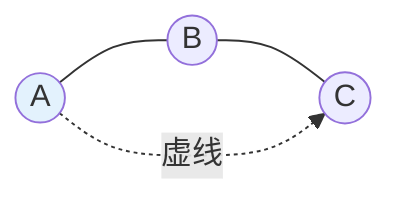

# 图形重绘强制规范总览（high-school-physics-problem-solver-animator 跨域统一要求）

> 本文件是「上传试题 → 生成零错误 HTML」时**所有图形**重绘的**最高优先级总规范**。
> 各分册（mechanics / electromagnetism / optics / oscillation_waves / principles / thermodynamics）的 **§9** 为本册在本领域下的细化；本文件与分册 §9 冲突时，以本文件为准。

---

## 0. 适用前提

- 本技能生成**自包含 HTML**：左栏「试题原题」、中栏「分步解析」、右栏「物理动画」三栏。
- 所有图形的几何来源有两类，但**只有 (b) 算「重绘」**，（a）只是像素搬运、不计入「重绘」；凡录入含图试题且要生成动画，**一律走 (b)**（重绘题图与右栏动画统一见 **§3.2 孪生锁定**）：
  - **(a) 嵌入题目原图位图（仅兜底，不计入「重绘」）**：用 `assets/img2b64.js` 转 data URI 填入 `PROBLEM.images[].src`，由 `` 原样显示——**这只是像素搬运，不满足「重新绘制」要求**；仅当图形确实无法用 `FIG.*` 表达（如照片式实物插图）或用户明确要求像素级原样时兜底。
  - **(b) 矢量重绘（默认 · 强制 · Canvas 2D 像素级，禁用 SVG viewBox）**：用 **JavaScript Canvas 2D 上下文 API**（`ctx.beginPath()` / `moveTo()` / `lineTo()` / `arc()` / `fillText()` 等）以**固定像素尺寸（如 800×600）硬编码**，按原图的**斜率、边长比例与交点坐标** 1:1 重绘（如斜面底边:高度约 4:3）；左栏 `<canvas class="fig-canvas">` 由 `drawStaticGraph(c)` 在 `t=0` 像素级绘制。**严禁使用 SVG `viewBox` 通用缩放另绘**静态题图（坐标会漂移、与动画脱节）。它**自带「完全自包含」**：模板已在 `renderProblem()` 之后补调 `drawFigures()`，保证页面加载即绘制——独立双击打开、脱离 WorkBuddy、无外部 CDN / 本地图片 / Web Worker 也必显示（彻底规避「Canvas 仅在 resize 时绘制 → 独立打开空白」的 bug）。右栏动画与左栏题图**共用同一套 `drawStaticGraph()` / `drawSceneBody()` / 世界坐标**（孪生锁定，见 §3.2），**动画第 0 帧＝左栏题图像素级重合**。
- **禁止**用文字描述替代图形；**禁止**手画矩形/折线冒充物理模型（电阻、质点、轨道等）；**禁止**用 SVG `viewBox` 通用缩放去「另绘」动画配对题图（坐标会漂移、破坏孪生锁定）。**纯静态几何重绘（§10，不生成动画）不受此限**——该场景允许 Mermaid / 内联 SVG（含 `viewBox` 响应式）。

---

## 0.1 题图渲染「完全自包含」硬要求（2026-09-08 确立）

**现象**：之前生成的 HTML 在 WorkBuddy 右侧预览能显示重绘题图，但单独保存、用浏览器双击打开却空白。根因：题图走 Canvas 孪生锁定（`__CANVAS_STATIC__`），而 `drawFigures()` 只在 `resize()` 内调用；`resize()` 在 `renderProblem()` **之前**执行，此时 `.fig-canvas` 尚未创建，故首绘落空；独立打开时没有任何 resize 事件触发补绘 → 题图永久空白。WorkBuddy 预览因为面板布局变化会触发 resize 才「侥幸」显示。

**硬要求（强制）**：录入试题重绘图时，重绘所得题图**必须完全自包含、独立双击打开即显示**，严禁以下任一情况：
- 依赖 WorkBuddy 环境 / 专有 API；
- 引用外部网络资源（CDN、外链脚本/字体）；
- 引用本地图片文件（除非是 data URI 兜底位图）；
- 仅靠 Canvas 在 resize 事件触发才绘制（独立打开无 resize 即空白）；
- 使用 `canvas.toDataURL()` 作为唯一渲染手段（依赖用户交互/异步）；
- 使用 Web Worker 等专有线程。

**已批准渲染路径（按题型二选一，均须「完全自包含 · 独立打开即显示」）**：
1. **路径 B · Canvas 2D 孪生锁定（默认 · 强制，用于「重绘题图 + 生成右栏动画」的常规题型）**：`PROBLEM.images[].src = "__CANVAS_STATIC__"`，左栏 `<canvas class="fig-canvas">` 在 `t=0` 由 `drawStaticGraph()` 绘制。模板已修复：在 `renderProblem()` 之后补调 `drawFigures()`，保证**页面加载即绘制，不依赖 resize 事件**——独立双击打开、脱离 WorkBuddy 也必显示。**严禁 SVG `viewBox` 通用缩放另绘**该静态题图（坐标漂移、破坏孪生锁定）。
2. **纯静态几何重绘（仅「只提取并重绘几何图形、不生成动画」时用，见 §10）**：可用 Mermaid 或**内联 SVG**（含 `viewBox` 响应式缩放）。此场景无动画配对，不存在孪生锁定坐标漂移问题，故允许 SVG；同样须完全自包含（Mermaid 由页面内脚本渲染 / SVG 内联注入）。

> **一句话边界**：**动图题 → 路径 B（Canvas，禁用 viewBox）；纯静态几何题 → §10（Mermaid/SVG，可含 viewBox）**。

**验收（强制）**：生成后用浏览器 / Playwright **直接打开 .html 文件（脱离 WorkBuddy 环境）**，确认题图非空白、无报错。

---

## 0.2 单位符号规范（电阻 Ω、面积/体积 m²/m³、加速度 m/s²，2026-09-08 确立）

生成解析与 HTML 时，**物理量单位符号必须规范、统一、且强制正体（upright，禁止斜体）**，与「单位强制正体」总原则（SKILL.md 第 7 条）一致：

- **电阻**：欧姆符号一律写字面 `Ω`，**禁止** `\Omega` 等 LaTeX 命令、禁止 `Ohm`/`ohm` 英文单词。数值与单位间用细空格（方程字段 `\,Ω`）或紧贴公式后的纯文本（文字字段 `\(R=2\) Ω`）。
- **面积 / 体积**：一律用 Unicode 上标 `m²`/`cm²`/`mm²`/`km²`/`m³`/`cm³`/`mm³`/`km³`，**禁止** `m^2`/`m2`/`m^3`/`m3` 这类代码式写法——尤其不能把 `^2`/`^3` 留在公式环境（`\(...\)`/`$$...$$`）之外的裸文本里（会原样显示成 `m^2`，正是「面积单位不规范」的根因）。
- **加速度**：一律用 Unicode 上标 `m/s²`，**禁止** `m/s^2`/`m/s2` 这类代码式写法——尤其不能把 `^2` 留在公式环境（`\(...\)`/`$$...$$`）之外的裸文本里（会原样显示成 `m/s^2`）；方程字段内也建议直接写 `m/s²` 而非 `m/s^2`。
- **其它单位**（kg、m/s、J、N、T、Wb、C、V、A 等）强制正体写法：公式环境外的单位作纯文本（如 `$m_A=0.4$ kg`，天然正体），必须嵌在数学式内时用 `\mathrm{}` 强制正体（如 `\,\mathrm{kg}`）。

> **验收（强制）**：生成后通读 HTML，确认电阻显示为 `Ω`（非 `\Omega` 源码）、面积/体积显示为 `m²`/`m³`（非 `m^2`/`m2`）、加速度显示为 `m/s²`（非 `m/s^2`/`m/s2`）；**单位强制正体**——公式环境外的单位天然正体，公式环境内单位必须渲染为正体（`\mathrm{}`）而非斜体（如 `m/s`、`kg`、`N`、`J`、`K` 不得显示为斜体）。

---

## 1. 总原则（图形位置无关 + 完美重绘 + 零臆造）

1. **图形位置无关（强制）**：无论图形在试题图片的哪个位置——左上、右下、跨栏、夹在文字间、与多题同页、作为整页试卷/截图的一部分——都必须**完整、完美**地提取并重绘/嵌入，**不得省略、裁切或只取局部**。
2. **方式③（多题同页 / 截图）**：上传整页试卷或截图时，先把图形所在区域单独切出（裁剪）再嵌入或重绘，确保只取本题相关图形。
3. **零臆造**：原题有什么就画什么，严禁自行增加原题没有的辅助元素（法线虚线、延长到图形外的线段、坐标轴、未标注的强调圆点、斜线填充替代原题的实心填充等）。左栏题图与右栏动画是两回事——动画可含法线/角度弧/轨迹，题图必须忠于原题。
4. **1:1 一致**：左栏题图与右栏动画几何必须完全一致；右栏动画**全部走 `FIG.*`**，不得手画。
> **录入试题即重绘（强制）**：凡题面含图形，生成 HTML 时一律按原图 **1:1 重新绘制**（方式 ② 矢量重绘），**禁止把原图位图直接塞进 `` 当作「已重绘」**。重绘结果须与原图在「几何结构 / 线型线宽 / 比例尺寸 / 角度与相对位置 / 字母标注 / 填充阴影 / 坐标系」7 个维度逐一吻合（完全相同）；嵌入原图位图（方式 ①）不计入「重绘」，仅当图形确实无法用 `FIG.*` 表达或用户明确要求像素级原样时兜底。

---

## 2. 多过程动画（过程数 = 题设过程数，强制）

- 试题含几个物理过程，动画演示就应有几个物理过程：**不得合并、也不得多出题目没有的过程**。
- 实现：按 `t` 在 `SIM.duration` 内分段对应每个过程，用 `FIG.processBanner(...)` 在动画顶部显示当前过程名（如「过程1：匀速直线运动」「过程2：磁场中圆周运动」）。
- 阶段切换时刻必须与解析中的过程转折点严格一致（碰撞瞬间、进入/离开磁场瞬间、脱离轨道瞬间、换路瞬间等）。
- 切换时轨迹/速度/受力连续无跳变，演示过程清晰明了。

---

## 3. 全教材 FIG 图元总表（覆盖整本高中物理教材图形）

下表逐行对应「题图要素 → 模板 `FIG.*` 图元」。生成页面时右栏动画必须全部使用下表图元，保证与题图 1:1 且不会因缺图元而出错。

| 章节 | 题图要素 | 对应 `FIG.*` | 零错误要点 |
|------|----------|-------------|-----------|
| 力学 | 水平弹簧 | `FIG.spring(x1,x2,y,{coils,amp})` | 圈数 `coils`、振幅 `amp`、两端连接点与题图**完全相同**；禁用竖直画法画水平弹簧 |
| 力学 | 竖直弹簧 | `FIG.springV(x,y1,y2,{coils,amp})` | 方向竖直，圈数/振幅与题图一致；禁用水平画法画竖直弹簧 |
| 力学 | 碰撞点/接触点 | `FIG.collisionPoint(x,y,{label})` | 高亮点须与题图碰撞位置**重合**，带字母标注 |
| 力学 | 质点模型 | `FIG.particle(x,y,r,{label,color})` | 实心小圆 + 质量 `m` 标注；禁止用手画矩形冒充质点 |
| 力学 | 直杆模型 | `FIG.rod(x1,y1,x2,y2,{double})` | 粗实线（双线可选）+ 两端铰点；杆长/倾角与题图一致 |
| 力学 | 竖直平面圆轨道 | `FIG.circleTrack(cx,cy,R,{arc})` | 双圆弧轨道环（顶/底/左/右关键点）；小球须**贴轨**运动 |
| 力学 | 弹簧振子 | 组合 `FIG.wall + FIG.springV + FIG.particle` | 平衡位置、振幅、周期与解析一致 |
| 力学 | 单摆 | `FIG.pendulum(px,py,len,angle,bobR,{...})` | 支点+摆线+摆球，`angle` 自竖直向下起算；动画走圆弧轨迹 |
| 力学 | 圆弧面（凹/凸） | `FIG.arcSurface(cx,cy,R,{a0,a1,solid})` | 角度区间 `a0→a1` 定凹/凸取向；实体时 `solid` 加斜线填充 |
| 力学 | 管道（含弯管） | `FIG.pipe(points,{...})` | 沿折线 `points` 的空心管；弯管多段折线，质点不穿管壁 |
| 力学 | 斜面 | `FIG.incline(x1,y1,x2,y2,{...})` | 楔形，倾角由两端高度差定；配 `FIG.angleArc` 标角度 |
| 力学 | 定滑轮+绳 | `FIG.pulley(x,y,r,{...})` | 滑轮 + 两侧绳 |
| 力学 | 墙壁/地面 | `FIG.wall(x,top,bottom)` / `FIG.ground(x1,x2,y)` | 粗线 + 斜线阴影 |
| 力学 | 物块 | `FIG.block(cx,cy,w,h,label)` | 矩形物块 + 标签 |
| 电磁 | 磁场向里 | `FIG.magInto(x1,y1,x2,y2,{step,size})` | 区域铺 ×（叉）标记，紫色 |
| 电磁 | 磁场向外 | `FIG.magOut(x1,y1,x2,y2,{step,size})` | 区域铺 ⊙（点圈）标记，紫色 |
| 电磁 | 磁感线（任意方向） | `FIG.magLines(x,y,ang,{...})` | `ang` 弧度：0=右、π/2=上、π=左、−π/2=下、任意斜向；紫色箭头 |
| 电磁 | 电场向里 | `FIG.eInto(x1,y1,x2,y2,{step,size})` | 区域铺 × 标记，蓝色 |
| 电磁 | 电场向外 | `FIG.eOut(x1,y1,x2,y2,{step,size})` | 区域铺 ⊙ 标记，蓝色 |
| 电磁 | 电场线（任意方向） | `FIG.eLines(x,y,ang,{...})` | `ang` 同磁感线约定；从 + 指向 −，蓝色箭头 |
| 电磁 | 点电荷 + | `FIG.chargePlus(x,y,r)` | 红 + ；电场线由 + 发出 |
| 电磁 | 点电荷 − | `FIG.chargeMinus(x,y,r)` | 蓝 − ；电场线终止于 − |
| 电磁 | 导线/开关 | `FIG.wire(...)` / `FIG.switchWire(...)` | 折线导线、断开/闭合开关 |
| 电磁 | 电源 | `FIG.battery(x,y,orient)` | 长线+短线，`h`/`v` 取向 |
| 电磁 | 电阻 | `FIG.resistor(x,y,orient,{style})` | 矩形（教材常见）/锯齿；**禁止手画矩形冒充** |
| 电磁 | 滑动变阻器 | `FIG.rheostat(x,y,orient,{tap})` | 电阻体+滑片箭头+三接线柱，`tap` 定滑片位置 |
| 电磁 | 电容/电感 | `FIG.capacitor(...)` / `FIG.inductor(...)` | 双平行板 / 半圆弧 |
| 电磁 | 灯泡/节点 | `FIG.lamp(...)` / `FIG.node(...)` | 圆内 X / 连接点实心圆 |
| 电磁 | 电流表/电压表/电流计 | `FIG.ammeter(...)` / `FIG.voltmeter(...)` / `FIG.galvanometer(...)` | 圆内 A / V / G |
| 光 | 光线（含折/反射） | `FIG.ray(pts,{...})` | 折线 `pts` 含折射/反射顶点，末端箭头；方向/折角与题图一致 |
| 光 | 薄透镜/平面镜/球面镜 | `FIG.lens(x,yt,yb,'convex'\|'concave',{f})` / `FIG.mirror(...)` | 透镜凸/凹、镜面类型、焦点 F/2F 位置与题图一致 |
| 振波 | 正弦波 | `FIG.wave(x,y,amp,λ,phase,{dir})` | 横波/纵波，振幅波长与题图一致 |
| 振波 | 波面/干涉/驻波 | `FIG.ripple(cx,cy,R,n)` + `FIG.standingWave(...)` + `FIG.particle` 标波节 | 波节/波腹位置正确 |
| 原理 | 矢量/合成 | `FIG.vec(...)` + 平行四边形/三角形 | 力/速度/加速度任意方向，长度∝大小 |
| 原理 | 坐标系 | `FIG.coord(x,y,len,{...})` | 带箭头坐标轴 |
| 原理 | 受力分析 | `FIG.forceArrow(...)` + `FIG.particle` | 自由体图，各力方向/大小正确 |
| 原理 | 运动图像 | 自定义 `ctx` 绘制 x-t / v-t 坐标与曲线 | 坐标轴 + 曲线与解析一致 |
| 热 | p-V 图 | `FIG.pvAxes(vmin,vmax,pmin,pmax)` + `FIG.pvCurve(pts,{...})` | 坐标轴标注 p/V，等温/等压/等容/绝热曲线正确 |
| 热 | 气缸+活塞 | `FIG.gasCylinder(x,y,w,h,{piston,rod})` | 活塞位置随状态变化；可加活塞杆+重物 |
| 通用 | 角度弧 | `FIG.angleArc(cx,cy,r,a0,a1,{label})` | 斜面/摆角/碰撞角标注 |
| 通用 | 多过程横幅 | `FIG.processBanner(text)` | 顶部过程提示（见 §2） |

> 表中「自定义 `ctx` 绘制」项表示模板暂无专用 `FIG.*`，须用 Canvas 2D API 按题图 1:1 手绘，并同样遵守「零臆造 / 1:1」原则；后续若高频出现，应沉淀为新 `FIG.*` 图元。

### 3.1 新增与补齐图元（2026-09 扩充：光学 / 热学 / 力学补充 / 电路补充 / 磁场补充 / 大学·强基）

> 以下图元已沉淀进 `assets/template.html` 的 `FIG.*`，覆盖此前「自定义 ctx」的光学/热学项，并补齐高中遗漏与大学/强基常用图元。
> 全部使用世界坐标 + `W2S` 映射，与 `drawFrame` 同坐标系；重绘仍须遵守 §6「完全相同＝7 维度」。

| 章节 | 题图要素 | 对应 `FIG.*` | 零错误要点 |
|------|----------|-------------|-----------|
| 光 | 主光轴 | `FIG.optAxis(x1,x2,y)` | 虚线水平中心线 |
| 光 | 薄透镜（会聚/发散） | `FIG.lens(x,yt,yb,'convex'\|'concave',{f})` | 凸/凹、F/2F 位置与题图一致 |
| 光 | 平面/球面镜 | `FIG.mirror(x,yt,yb,'plane'\|'concave'\|'convex')` | 镜面类型、背面斜线阴影 |
| 光 | 物/像箭头 | `FIG.objArrow(x,y,h,{dashed})` | 正立/倒立、虚像用 `dashed` |
| 光 | 光屏 | `FIG.screen(x,yt,yb)` | 竖直屏 + 斜线阴影 |
| 光 | 棱镜（色散） | `FIG.prism(pts,{label})` | 三角形顶点与题图一致 |
| 光 | 双缝/光栅挡板 | `FIG.barrier(x,y,h,slits)` | `slits` 为缝的世界 y 坐标数组 |
| 光 | 偏振片 | `FIG.polarizer(x,yt,yb)` | 透光轴双箭头 |
| 光 | 水波/干涉同心圆 | `FIG.ripple(cx,cy,R,n,{source})` | 波源 + 等间距圆环 |
| 振波 | 驻波 | `FIG.standingWave(x1,x2,y,amp,n,{nodes})` | 波节（红点）/波腹位置正确 |
| 振波 | 参考圆/相量 | `FIG.phasor(cx,cy,R,th,{project})` | SHM 旋转矢量 + 竖直投影 |
| 热 | p-V 坐标轴 | `FIG.pvAxes(vmin,vmax,pmin,pmax)` | 自动标注 V/p |
| 热 | p-V 过程曲线 | `FIG.pvCurve(pts,{label,markers})` | 等温/等压/等容/绝热方向正确 |
| 热 | 气缸+活塞 | `FIG.gasCylinder(x,y,w,h,{piston,rod})` | 活塞位置随状态变化 |
| 热 | 温度计 | `FIG.thermometer(x,y,len,{fill})` | 液柱比例 `fill` |
| 热 | U 形管压强计 | `FIG.utube(x,y,w,h,{fillL,fillR})` | 两侧液柱高度差 |
| 热 | 热源/热库 | `FIG.heatBath(x,y,w,h,{label})` | 斜线阴影 + T 标注 |
| 热 | 分子点云 | `FIG.moleculeCloud(pts)` | 分子动理论散点 |
| 力学 | 力的平行四边形 | `FIG.forceParallelogram(ox,oy,v1,v2,{labels})` | 两分力+合力，颜色区分 |
| 力学 | 运动轨迹 | `FIG.trajectory(pts,{dash})` | 平抛/斜抛抛物线等 |
| 力学 | 椭圆轨道 | `FIG.ellipseOrbit(cx,cy,a,b,{bodyFrac})` | 焦点恒星 + 行星位置 |
| 力学 | 力臂 | `FIG.momentArm(ox,oy,px,py,fx,fy,{label})` | 支点到力线垂直虚线 |
| 力学 | 质心 | `FIG.com(points,{label})` | 多点等质量质心 |
| 电磁 | 螺线管 | `FIG.solenoid(x1,x2,y,{field})` | 线圈半圆 + 内部 ×/⊙ |
| 电磁 | 条形磁铁 | `FIG.barMagnet(x,y,len,{field})` | N/S 着色 + 外场线 |
| 电磁 | 环形电流 | `FIG.currentLoop(cx,cy,R,{axis})` | 法向磁场箭头 |
| 电路 | 交流电源 | `FIG.acSource(x,y)` | 圆内正弦 |
| 电路 | 理想电流源 | `FIG.currentSource(x,y)` | 圆内箭头 |
| 电路 | 变压器 | `FIG.transformer(x,y,{n1,n2})` | 铁芯 + 原/副线圈 |
| 电路 | 二极管 | `FIG.diode(x,y,{flip,glow})` | 三角+竖条，`glow`=LED |
| 电路 | 接地 | `FIG.groundSym(x,y)` | 三条递减横线 |
| 电路 | 保险丝 | `FIG.fuse(x,y)` | 圆内波浪线 |
| 电路 | 电动机/发电机 | `FIG.machine(x,y,'M'\|'G')` | 圆内 M/G |
| 强基 | 能级图 | `FIG.energyLevels(levels,transitions)` | 能级横线 + 跃迁箭头（发射↓/吸收↑） |
| 强基 | 一维方势阱 | `FIG.quantumWell(x,y,w,V0,{levels})` | 势函数 + 束缚态能级 |
| 强基 | 玻尔轨道 | `FIG.bohrOrbit(cx,cy,radii,{electron,phase})` | 同心圆轨道 + 电子 |
| 强基 | 时空图 | `FIG.spacetime(ox,oy,{worldline,labels})` | t/x 轴 + 光锥 |
| 强基 | 刚体转动圆盘 | `FIG.rigidDisk(cx,cy,R,{label})` | ω 弧形箭头 |
| 强基 | 角动量/力矩矢量 | `FIG.axisVec(cx,cy,len,label)` | 沿转轴矢量 + 轴端圆 |
| 强基 | 原子核 | `FIG.nucleus(cx,cy,Z,N,{label})` | 质子(红)/中子(蓝)团簇 |
| 强基 | 流体流线 | `FIG.streamline(pts,{head})` | 平滑曲线 + 流向箭头 |

---

## 3.2 四大图形约定（GEOMETRY_REVERSE_ENGINEERING / CANVAS_PIXEL / TWIN_LOCK / CONSISTENCY_CHECKLIST）+ GREEK_SYMBOLS

> 本节能补 §3（FIG 图元）与 §6（线条图形重绘）：当用户**既要重绘题图、又要生成右栏动画**时，左栏题图与右栏动画**不是两张独立的图**，而是同一套绘制函数在两个端点的产物。详细步骤见 SKILL.md「## 图形重绘工作流」（四大约定 + [GREEK_SYMBOLS]）。本节能述强制要点。

### 3.2.1 [GEOMETRY_REVERSE_ENGINEERING] + [CANVAS_PIXEL]：几何结构反编译与绝对坐标重建（Geometry Reverse-Engineering · Canvas 2D 像素级，禁用 viewBox）

- **不得凭空「画」相似图形**：必须**反编译**原题图的几何结构，提取四类**几何基元（Geometric Primitives）**并在 CoT 中显式列出：
  1. **顶点坐标**：所有交点、端点、质心、圆心的相对二维坐标（以画布左上角为原点，记录 X、Y 像素级相对位置）；
  2. **线段与路径**：直线、虚线段、箭头线、圆弧的**起点—终点—曲率**；
  3. **角度标注弧**：表示 θ、α 等角度的弧形标记位置；
  4. **文字锚点**：每个物理符号（m、F、v₀ 等）在图中标注的精确落点位置。
  5. **题图标签的下标（强制）**：题图由 Canvas 2D 的 `FIG.text`/`FIG.vec` → `ctx.fillText` 像素级绘制，**不经 MathJax**，所以带下标的标签必须写 **Unicode 下标字符** `R₁`/`R₂`/`v₀`/`I₁`，**严禁写字面 `R_1`/`R_2`/`v_0`**（canvas 无法渲染 LaTeX，会原样显示成带下划线的 `R_1`）。而题面/解析/数据面板等 HTML 文本语境经 MathJax 排版，下标则写 `\(R_1\)`/`\(v_0\)`。两者不要混淆。
- **绘图技术约束**：必须生成 **JavaScript Canvas 2D 上下文代码**，用 `beginPath()` / `moveTo()` / `lineTo()` / `arc()` / `fillText()` 等 API 进行**像素级绘制**。
- **禁止行为**：**严禁使用 SVG 的通用缩放（`viewBox`）**重绘静态题图；必须使用**固定像素尺寸**（如 800×600）硬编码绘图，以确保坐标不漂移。左栏题图统一由 `drawStaticGraph(c)` 在 `<canvas class="fig-canvas">` 上以 `t=0` 绘制。

### 3.2.2 [TWIN_LOCK]：动画与静态图形的「孪生锁定」（Twin-Lock Mechanism）

- **核心**：动画演示**不是重画**，而是**操作**步骤 ② 生成的同一图形。右栏动画区初始化**直接复用**左图同一套绘制函数——`drawStaticGraph()` / `drawSceneBody()`（其背景层即左图的 `drawBackground()` 底图）——作为动画底图，**不得另写一套坐标**。
- **背景层（Background Layer）**：凡不动的元素（斜面、地面、轨道轮廓、固定墙壁等）**仅绘制一次**在背景层，动画每帧不再重绘。
- **移动层**：只移动该动的元素（滑块、小球、箭头矢量），其移动轨迹**严格遵循解析中的运动方程**（如 $x(t)=v_0t+\tfrac12at^2$）。
- **绝对一致规则**：动画第 0 帧（初始状态）必须与左栏静态重绘图形**像素级完全重合**（同一 `W2S`、同一世界坐标 `VIEW`、同一 `drawSceneBody(0)`）。

### 3.2.3 [CONSISTENCY_CHECKLIST]：图形一致性自检清单（Consistency Checklist）

生成 HTML 前，在思维链（CoT）中隐式核对：

- **[CHECK_1]** 动图中斜面角 θ 与左图**绝对相等**——必须使用**同一个变量** `const theta = 30 * Math.PI/180` 控制，不得两处各写角度值而漂移。
- **[CHECK_2]** 动图中矢量箭头长度比例与左图一致——例如左图 $F=10\,\mathrm{N}$ 画 50px，则比例尺 `scale = 5px/N`，动图必须用**同一 `scale`**。
- **[CHECK_3]** 动图中标签（$v$、$a$ 等）移动时始终锚定物体**同一相对位置**（如右上角），不得随帧漂移。

> 三项任意一项不符即回到 `drawSceneBody()` / `W2S` 修正后重验。该机制由模板 `assets/template.html` 的 `drawStaticGraph(c)` + `drawFigures()` 落地（见 SKILL.md「## 图形重绘工作流」与质量门禁 23/24 项）。

---

## 4. 零错误交付门禁（与 SKILL.md「质量门禁」16/17 项合并执行）

1. 左栏题图完整（含全部子图，无遗漏、无裁切），无论原图位于试卷何处均已提取；
2. 右栏动画几何全部来自 `FIG.*`（或经审批的自定义 1:1 绘制）且与题图一致；
3. **磁场/电场场线方向正确**：向里 × / 向外 ⊙ / 左 / 右 / 上 / 下 / 任意方向，标记样式与题图一致；
4. **圆弧面/管道/斜面取向正确**，质点不穿管壁、小球贴轨；
5. **弹簧方向/圈数/振幅**与题图相同（水平弹簧禁竖直画、竖直弹簧禁水平画）；
6. **碰撞点/质点/直杆/圆轨道/单摆/弹簧振子**模型正确（实心圆、铰点、双圆弧环、圆弧轨迹）；
7. **电路元件符号齐全**：电源/电阻/滑动变阻器（含滑片箭头+三接线柱）/电容/电感/仪表/导线/开关/节点，无手画矩形冒充、无漏连接点圆点；
8. **多过程动画过程数 = 题设过程数**且 `processBanner` 命名一致；
9. 抽取内联 JS 通过 `node --check`；用无头浏览器打开后控制台无报错、canvas 已绘制非空白。

---

## 5. 分册对应索引

- 力学：`mechanics_reference.md` §9
- 电磁学：`electromagnetism_reference.md` §9
- 光学：`optics_reference.md` §9
- 机械振动与机械波：`oscillation_waves_reference.md` §9
- 物理基本原理与方法：`principles_reference.md` §9
- 热学：`thermodynamics_reference.md` §9

---

## 6. 线条图形（line graphics）重绘专项规范

> 用户专项要求：**试题中的图形是线条图形，必须「按照原线条图形重新绘制成完全相同的线条图形」**。

本技能处理的题图绝大多数是「线条图形」——由**线条**（实线/虚线/点划线、带箭头直线或弧线）、**几何形状**（矩形物块、圆/圆弧轨道、弹簧锯齿线、电路符号、光路/波前线）与**字母标注**（A/B/C/F/m/θ/v₀ 等）构成。对此类图形，统一强制：

1. **默认「重绘」而非「贴图」**：优先用 `FIG.*` 图元（或经审批的自定义 `ctx` 1:1 绘制）**重新绘制**出与原件**完全相同**的线条图形；仅当图形无法用 `FIG.*` 表达（如照片式实物插图）或用户明确要求像素级原样时，才允许「方式①」直接嵌入原图。
2. **「完全相同」＝ 7 维度逐一吻合（强制）**：重绘后必须与原线条图形在以下 7 个维度逐项一致，任一不符即重绘失败：
   - ① **几何结构**：元素种类与连接方式（墙/地/弹簧/轨道/电路元件的拓扑）一致；
   - ② **线型·线宽·箭头**：实线/虚线/点划线、线宽、箭头样式（实心/空心）一致；
   - ③ **比例与尺寸**：各元素相对大小、间距、长度比例（如墙高:物块宽、弹簧圈数）一致；
   - ④ **角度与相对位置**：斜面倾角、摆角、碰撞夹角、各物体相对坐标一致；
   - ⑤ **标注符号**：字母标注的内容与位置一致；
   - ⑥ **填充阴影**：原题实心填充不替为斜线、原斜线阴影不省略；
   - ⑦ **坐标系一致**：题图与动画共用同一 `VIEW` 世界坐标与比例尺，确保「左栏题图＝右栏动画暂停态」。
3. **零臆造**：原图没有的辅助线、法线、延长线、网格、额外圆点一律不画；原图有的一个都不能少、不能改。
4. **逐线核对**：重绘后把左栏题图与右栏动画暂停态并排，按上述 7 维度**逐线**核对，差异即回到 `drawFrame`/`FIG.*` 修正，直至两条线完全重合。

> 本专项与 §3 的 FIG 图元总表、§4 的零错误门禁合并执行；分册 §9 已按领域细化，冲突时以本节「完全相同＝7 维度」为准。

---

## 10. 上传图片几何图形重绘（Mermaid/SVG 工作流 · 与 FIG.* 双轨）

> 本节能补 §3（FIG 图元总表）与 §6（线条图形重绘专项）：当用户**只从试题图片提取并重绘几何图形/示意图、不生成动画**时，按本节的 Mermaid/SVG 工作流处理；它与 FIG.* 画布库**双轨并存**——FIG.* 服务动画 1:1，本节服务静态几何还原。完整定义（步骤/输出格式/示例）见 SKILL.md「## 上传图片几何图形重绘」。
> **⚠ 与 §3.2 孪生锁定的边界**：本节 Mermaid/SVG（含 `viewBox`）路径**仅适用于「不生成动画」的纯静态几何还原**。一旦同题还要生成右栏动画，左栏题图**必须改走 §3.2 的 Canvas 孪生锁定**（`drawStaticGraph()` 在 `<canvas class="fig-canvas">` 以 `t=0` 绘制），**严禁对动画配对题图使用 SVG `viewBox` 通用缩放**（坐标会漂移，违反孪生锁定的像素级一致）。即：动图题 → §3.2（Canvas，禁用 viewBox）；纯静态题 → 本节（Mermaid/SVG 可含 viewBox）。

### 10.1 强制要求
1. **只提取几何图形**：忽略图片中所有文字（题目、选项、标注文字、字母），仅关注几何结构。
2. **识别基本元素**：点、线（实线/虚线/点划线）、面、角度、弧线、圆/圆弧。
3. **重绘工具**：优先 **Mermaid**；带角度/弧线/复杂比例时改用 **SVG**。
4. **保持几何关系**：平行 `∥`、垂直 `⊥`、相等 `=`、比例、对称必须与原图一致。
5. **标准几何标记**：直角 `∟`、平行 `∥`、垂直 `⊥`、相等标记。

### 10.2 三步流程
- **步骤 1 图形解析**：描述所有几何元素（顶点数、边数、特殊关系），列出可见标注（角度值、长度、特殊符号）；忽略文字。
- **步骤 2 图形重建**：优先 Mermaid；建立坐标系保持比例；用颜色/线型区分元素。
- **步骤 3 输出代码**：提供完整可直接渲染的 Mermaid/SVG（含样式）；附图形说明（顶点、边长/角度关系、特殊性质）。

### 10.3 输出格式
**Mermaid（优先）**：

> 说明：△ABC；AB、BC 实线，AC 虚线。

**SVG（复杂几何优先）**：
```svg
<svg viewBox="0 0 200 160" xmlns="http://www.w3.org/2000/svg">
  <line x1="20" y1="140" x2="180" y2="140" stroke="#333" stroke-width="2"/>
  <line x1="20" y1="140" x2="100" y2="40" stroke="#333" stroke-width="2"/>
  <line x1="100" y1="40" x2="180" y2="140" stroke="#333" stroke-width="2"/>
  <path d="M100,40 L120,40 L120,60 L100,60 Z" fill="none" stroke="#333"/>
</svg>
```
> 几何特征：等腰 △ABC，顶点 A 直角（小方框），AB = AC。

### 10.4 与 FIG.* 的关系
- 生成**带动画 HTML** → 仍用 FIG.* 1:1 重建（§3、§6）；
- 只要**静态几何图形** → 用本节 Mermaid/SVG；
- 两者都要求零臆造、几何关系完全一致。
